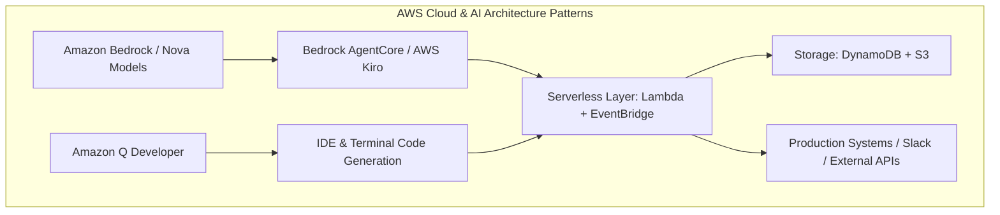
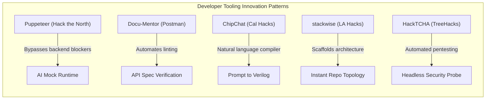
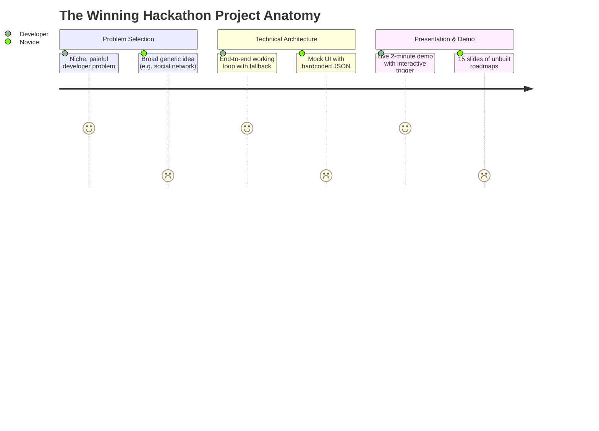

# Deep-Dive Study: 21 Hackathon-Winning Projects in Software Development & Developer Tooling

This study analyzes **21 top-tier hackathon-winning software development projects**, curated specifically across major developer challenges and hackathons. It features **11 Amazon / AWS Hackathon Winners** and **10 Premier Global & Collegiate Hackathon Winners** (Hack the North, Cal Hacks, TreeHacks, Postman Global Hack, ETHGlobal, LA Hacks, Hack@Brown).

---

## Executive Summary & Comparative Matrix

| # | Project Name | Hackathon & Year | Sponsoring Host / Entity | Key Award Won | Primary Software Domain | Core Tech Stack |
|---|--------------|------------------|--------------------------|---------------|-------------------------|-----------------|
| **1** | **Compliance Guardian** | AWS AI Agent Global Hackathon (2024–2025) | Amazon Web Services / Devpost | **Best Amazon Q Application** | Cloud Compliance & DevSecOps | Amazon Q, Bedrock (Nova), Lambda, DynamoDB, FastAPI |
| **2** | **AgentShell** | AWS AI Agent Global Hackathon (2024–2025) | Amazon Web Services / Devpost | **Best Strands SDK Implementation** | Agentic Infrastructure & MCP Control | Strands Agents SDK, Bedrock, AWS IoT Core, Lambda |
| **3** | **AegisAgent** | AWS AI Agent Global Hackathon (2024–2025) | Amazon Web Services / Devpost | **2nd Place Overall** | Automated Reasoning & Verification | AWS Kiro, Amazon Bedrock, Step Functions, OpenSearch |
| **4** | **EcoLafaek** | AWS AI Agent Global Hackathon (2024–2025) | Amazon Web Services / Devpost | **1st Place Overall (Grand Prize)** | Distributed Agentic Multimodal Pipeline | Bedrock Nova-Pro, AgentCore, S3, DynamoDB, Expo |
| **5** | **Province** | AWS AI Agent Global Hackathon (2024–2025) | Amazon Web Services / Devpost | **3rd Place Overall** | Deterministic Multi-Agent State Machines | Bedrock (Claude 3.5 Sonnet), Step Functions, DynamoDB |
| **6** | **Hubsy** | AWS Chatbot Challenge (2017) | Amazon Web Services & Slack | **2nd Place Overall** | Conversational DevOps & ChatOps | Amazon Lex, AWS Lambda, CloudWatch, Node.js, Slack |
| **7** | **BuildFax Counts** | AWS Chatbot Challenge (2017) | Amazon Web Services & Slack | **1st Place Overall (Grand Prize)** | Conversational Data & API Abstraction | Amazon Lex, AWS Lambda, API Gateway, DynamoDB |
| **8** | **Smart Meeting Assistant** | AWS Lambda Hackathon | Amazon Web Services | **Top Winner (Developer Productivity)** | Serverless Event Pipelines & Jira Integration | AWS Lambda, S3, Transcribe, Comprehend, Jira API |
| **9** | **Serverless Forest Monitor** | AWS Lambda Hackathon | Amazon Web Services | **Winner (Geospatial & Cloud Infrastructure)** | High-Throughput Satellite Data Processing | AWS Lambda, Amazon S3, SageMaker, EventBridge |
| **10** | **FBF: Farm, Build, Fight!** | AWS Game Builder Challenge | Amazon Web Services | **Best Game / Overall Winner** | AI-Augmented Game Dev & State Sync | Amazon Q Developer, Bedrock, Cognito, DynamoDB, Unity |
| **11** | **DisaVu** | AWS Disaster Response Hackathon | Amazon Web Services | **1st Place Winner** | ML-Driven Spatial Resource Routing | SageMaker Studio Lab, Lambda, S3, CloudFront |
| **12** | **Puppeteer** | Hack the North 2025 | University of Waterloo / Warp | **Overall Finalist & Best Developer Tool** | Terminal Runtime Mocking & Emulation | TypeScript, Warp CLI, LLM Runtime Generators, Node |
| **13** | **ChipChat** | UC Berkeley AI Hackathon (Cal Hacks) | UC Berkeley / Cal Hacks | **Winner: Productivity & Dev Tools** | Hardware Description Language (HDL) Compiler | Python, PyVerilog, OpenLane, GPT-4/Claude, Next.js |
| **14** | **Docu-Mentor** | Postman API Hack ($100k Challenge) | Postman | **Intergalactic Grand Prize ($25,000)** | API Documentation Quality & Schema Linting | Postman Platform, OpenAPI 3.0, Newman, Node.js |
| **15** | **Webhook Debugger** | Postman API Hack | Postman | **Andromeda Prize ($15,000)** | Async API Testing & Webhook Inspection | Postman Workspaces, Node.js, WebSockets, Ngrok |
| **16** | **OpenAPI Operations** | Postman API Hack | Postman | **Nebula Prize ($10,000)** | Microservice Boundary Analysis & Testing | OpenAPI Spec, Postman Collections, Newman, GitHub Actions |
| **17** | **stackwise** | LA Hacks 2025 | UCLA / Warp | **Warp: Best Developer Tool** | Full-Stack Scaffolding & Architecture AI | Python, Flask, Google Gemini API, Docker, Warp CLI |
| **18** | **Codex** | Hack@Brown 2025 | Brown University / Warp | **Best Developer Tool by Warp** | Terminal Workflow & Git Productivity Suite | Python, FastAPI, SQLite, Redis, Warp Extensions |
| **19** | **HackTCHA** | TreeHacks 2025 | Stanford University / Codegen | **Best Developer Tool by Codegen** | Automated Bot-Defense Pentesting Harness | Python, Playwright, OpenCV, PyTorch, Docker |
| **20** | **Industry.ai** | ETHGlobal Bangkok (2024) | ETHGlobal / Coinbase CDP | **1st Place CDP SDK & Multi-Track Winner** | Modular Agent Tooling & Hot-Swappable SDKs | Coinbase CDP SDK, OnchainKit, Base, Next.js, LangChain |
| **21** | **SuperBoard (Blockscout SDK)** | Superhack (ETHGlobal) | ETHGlobal / Blockscout | **1st Place Blockscout Prize** | Blockchain Developer Analytics & Python SDK | Blockscout Python SDK, GraphQL, FastAPI, React |

---

# Part 1: Detailed Studies of 11 Amazon / AWS Hackathon Winners

---

### Project 1: Compliance Guardian
* **Hackathon:** AWS AI Agent Global Hackathon
* **Award Won:** Best Amazon Q Application
* **Domain:** DevSecOps, Continuous Compliance, Automated Remediation
* **Official Links / Reference:** Devpost AWS AI Agent Showcase

#### 1. Problem Statement & Real-World Gap
Modern DevOps teams deploy infrastructure across multiple environments daily. Keeping infrastructure compliant with rigorous regulatory frameworks (HIPAA, GDPR, SOC 2, PCI-DSS) is traditionally a slow, manual auditing process. When audits flag issues, developers receive cryptic tickets without context or concrete remediation code, resulting in compliance drift and delayed deployment cycles.

#### 2. Technical Architecture & Innovation
Compliance Guardian acts as a 24/7 automated compliance officer integrated into CI/CD pipelines and runtime environments:
1. **Schema & Policy Ingestion:** Parses complex compliance frameworks into machine-interpretable policy vectors.
2. **Infrastructure Scrutiny:** Leverages Amazon Q and AWS Bedrock (Amazon Nova foundation models) to inspect infrastructure definitions (CloudFormation, Terraform) and live AWS resource configurations via Boto3.
3. **Risk Scoring Engine:** Computes real-time threat-level metrics and identifies severity discrepancies.
4. **Automated Remediator:** Generates drop-in pull requests and Infrastructure-as-Code (IaC) patches that remediate the violation directly.

#### 3. Tech Stack
* **AWS Services:** Amazon Q Developer, Amazon Bedrock (Nova Premier/Pro), AWS Lambda, Amazon DynamoDB, Amazon RDS, AWS IAM, Boto3.
* **Backend:** Python, FastAPI, Redis.
* **Integrations:** GitHub Webhooks, Slack Bot API.

#### 4. Why It Won
* **Deep Sponsor Tool Alignment:** Explicitly demonstrated the cutting-edge utility of Amazon Q Developer in an enterprise workflow rather than treating it as a generic chat interface.
* **Closed-Loop Execution:** It didn't just highlight misconfigurations; it produced verified code patches that closed the loop.
* **True Serverless Architecture:** Zero idle infrastructure cost using event-driven Lambda triggers on AWS CloudTrail events.

#### 5. Hackathon Takeaways
* *Playbook Tip:* When entering sponsor tracks (e.g., "Best Use of Amazon Q"), embed the sponsor tool into the core decision-making loop of your pipeline, not merely as a chatbot widget on your frontend.

---

### Project 2: AgentShell (From Model Context to Control)
* **Hackathon:** AWS AI Agent Global Hackathon
* **Award Won:** Best Strands SDK Implementation
* **Domain:** Edge Computing, Model Context Protocol (MCP), Agentic Hardware Drivers

#### 1. Problem Statement & Real-World Gap
The Model Context Protocol (MCP) has rapidly standardized how LLMs fetch context from external tools. However, almost all MCP implementations were purely read-only or software-bound (e.g., reading files, querying databases). Developers lacked a bi-directional framework enabling LLM agents running in cloud infrastructure to control physical hardware, video inputs, and peripheral devices safely.

#### 2. Technical Architecture & Innovation
AgentShell inverted the MCP paradigm from passive "information retrieval" to active "physical embodiment":
1. **Control Runtime:** Connects an Amazon Bedrock agent running in AWS to local hardware devices (cameras, robotic actuators, sensor arrays) using the Strands Agents SDK.
2. **Dynamic Tool Manifests:** Exposes edge hardware functions as dynamically discoverable MCP tools.
3. **Low-Latency Feedback Loop:** Uses AWS IoT Core and WebSockets to transmit sensory feeds to Amazon Nova multimodal models and stream control parameters back down to device micro-controllers in sub-second intervals.

#### 3. Tech Stack
* **AWS Services:** Strands Agents SDK, Amazon Bedrock (Nova Multimodal), AWS IoT Core, AWS Lambda, AWS Systems Manager.
* **Software / Edge:** Python, WebSockets, Raspberry Pi / Edge Camera APIs, OpenCV.

#### 4. Why It Won
* **Paradigm Shift:** The judges recognized a foundational theoretical leap: using MCP not just as an API connector, but as a universal device driver abstraction for AI agents.
* **Live Demo Impact:** The author demonstrated real-time physical camera adjustment and sensory tracking directed autonomously by the cloud agent.

#### 5. Hackathon Takeaways
* *Playbook Tip:* Look at emerging open-source standards (like MCP) that everyone uses for one specific use case, and demonstrate an entirely unexpected second use case.

---

### Project 3: AegisAgent
* **Hackathon:** AWS AI Agent Global Hackathon
* **Award Won:** 2nd Place Overall
* **Domain:** Automated Insurance Verification, Multi-Agent Reasoning, Explainability

#### 1. Problem Statement & Real-World Gap
Adjudicating claims against hundreds of pages of insurance policy riders requires meticulous cross-referencing of medical records, receipts, and policy exclusions. Human adjusters spend days per claim, while naive single-prompt LLM wrappers hallucinate approvals or fail to cite specific clauses, creating regulatory and financial liability.

#### 2. Technical Architecture & Innovation
AegisAgent utilized a hierarchical multi-agent architecture built with **AWS Kiro**:
1. **Intake & OCR Agent:** Normalizes unorganized PDFs, bills, and physician notes using AWS Textract into clean JSON schemas.
2. **Policy Clause Retrieval Agent:** Uses Amazon OpenSearch Service with vector embeddings in Amazon Bedrock to retrieve exact clauses relevant to the claim.
3. **Adjudication Reasoner:** Executes multi-step chain-of-thought verification via AWS Step Functions, evaluating claim criteria against policy exclusions.
4. **Auditability & Explainability Generator:** Every approval or rejection is paired with an exact clause citation, confidence score, and verifiable audit log.

#### 3. Tech Stack
* **AWS Services:** AWS Kiro, Amazon Bedrock (Claude 3.5 Sonnet / Nova), AWS Step Functions, Amazon OpenSearch Service, Amazon S3, AWS Lambda.
* **Languages & Frameworks:** Python, FastAPI, React/Tailwind frontend.

#### 4. Why It Won
* **100% Deterministic Auditability:** Judges praised the fact that no decision was a "black box"—the system provided an air-tight evidentiary trail.
* **Production-Grade Architecture:** Leveraged AWS Step Functions for state recovery, retries, and human-in-the-loop approvals.

#### 5. Hackathon Takeaways
* *Playbook Tip:* In high-stakes domains (finance, legal, compliance), never pitch "AI makes the final decision." Pitch "AI acts as a tireless junior analyst generating air-tight audit dossiers with human-in-the-loop verification."

---

### Project 4: EcoLafaek
* **Hackathon:** AWS AI Agent Global Hackathon
* **Award Won:** 1st Place Overall (Grand Prize Winner)
* **Domain:** Environmental Engineering, Citizen Mobile Reporting, Autonomous Logistics

#### 1. Problem Statement & Real-World Gap
In developing nations such as Timor-Leste, municipal solid waste management suffers from fragmented reporting, zero real-time visibility into illegal dump sites, and severely constrained municipal cleanup trucks. Paper-based complaints take weeks to process, leading to severe ecological hazards.

#### 2. Technical Architecture & Innovation
EcoLafaek integrated a hyper-accessible citizen mobile frontend with an autonomous backend dispatch agent:
1. **Citizen Ingestion:** Users capture photos and coordinates of waste hotspots via a lightweight mobile client.
2. **Multimodal Analysis:** Images are uploaded to Amazon S3, triggering an AWS Lambda function that invokes **Amazon Bedrock Nova-Pro**. Nova-Pro classifies waste type (organic, toxic, plastic, electronic), estimates volume, and calculates hazard levels.
3. **Autonomous Logistics Agent:** Bedrock AgentCore orchestrates routing algorithms that group nearby reports and optimize daily municipal vehicle routes dynamically.
4. **Public Geospatial Dashboard:** Updates a live Mapbox/Leaflet heatmap backed by Amazon DynamoDB.

#### 3. Tech Stack
* **AWS Services:** Amazon Bedrock (Nova-Pro), Bedrock AgentCore, AWS Lambda, Amazon S3, Amazon DynamoDB, Amazon API Gateway, Amazon CloudWatch.
* **Frontend:** React Native (Expo), TypeScript, Leaflet/Mapbox.

#### 4. Why It Won
* **Humanitarian & Global Impact:** Tackled an authentic, neglected problem in a developing region with an immediately viable solution.
* **Zero Fluff Implementation:** Built a fully operational mobile-to-cloud pipeline with working computer vision and route optimization within the hackathon timeframe.

#### 5. Hackathon Takeaways
* *Playbook Tip:* Projects combining technical sophistication with clear, tangible social good consistently outscore pure commercial prototypes in global hackathon finals.

---

### Project 5: Province
* **Hackathon:** AWS AI Agent Global Hackathon
* **Award Won:** 3rd Place Overall
* **Domain:** Conversational Multi-Agent Workflows, State Machine Tax Engine

#### 1. Problem Statement & Real-World Gap
Tax filing is notorious for cognitive overload, dense bureaucratic jargon, and error-prone multi-page forms. Traditional tax software forces users through rigid, hundreds-of-questions wizards, while conversational AI often fails at the strict arithmetic and legal boundaries mandated by tax codes.

#### 2. Technical Architecture & Innovation
Province paired conversational fluidness with rigorous financial validation:
1. **Supervisor-Worker Agent Architecture:** A central dispatcher agent evaluates conversational context and delegates tasks to specialized sub-agents (Deductions Agent, Income/W-2 Agent, Filing Status Agent).
2. **Deterministic Calculation Sandbox:** When numbers are collected, the agents do not perform math in the prompt; they execute sandboxed Python calculation routines via AWS Lambda.
3. **Contextual Memory & State Checkpointing:** User answers and form states are incrementally persisted to Amazon DynamoDB, allowing users to pause and resume across devices without losing progress.

#### 3. Tech Stack
* **AWS Services:** Amazon Bedrock (Claude 3.5 Sonnet), Amazon Bedrock Knowledge Bases, AWS Lambda, Amazon DynamoDB, AWS Cognito.
* **Frontend:** Next.js, Tailwind CSS, Web Speech API.

#### 4. Why It Won
* **Separation of LLM & Math:** Judges were impressed that the team avoided LLM math hallucinations by routing all calculations through deterministic Lambda functions.
* **UX Simplicity:** Transformed an adversarial 40-page tax questionnaire into an intuitive 5-minute interactive interview.

#### 5. Hackathon Takeaways
* *Playbook Tip:* Never let an LLM do arithmetic directly. Use tool-calling or sandboxed lambdas for all calculations and present the LLM only with the verified output.

---

### Project 6: Hubsy (The HubSpot & Cloud ChatOps Bot)
* **Hackathon:** AWS Chatbot Challenge (Devpost & Slack)
* **Award Won:** 2nd Place Overall
* **Domain:** ChatOps, Developer Tooling, Workflow Automation

#### 1. Problem Statement & Real-World Gap
Developers, marketers, and operations engineers lose hours each week switching contexts between IDEs, Slack, and heavy web dashboard interfaces like HubSpot or cloud management consoles just to check stats, trigger deployments, or update leads.

#### 2. Technical Architecture & Innovation
Hubsy brought complete administrative control directly into team chat:
1. **Natural Language Intent Parsing:** Amazon Lex processes unstructured developer chat messages (e.g., *"Show me the status of our staging deployment"* or *"Pull user signups from the past 2 hours"*).
2. **Lambda Fulfillment Engine:** AWS Lambda handles intent fulfillment, authenticating against OAuth providers and querying external APIs with connection pooling.
3. **Dynamic Response Cards:** Rather than plain text responses, Hubsy returns interactive Slack blocks and cards with inline action buttons allowing one-click approvals.

#### 3. Tech Stack
* **AWS Services:** Amazon Lex, AWS Lambda, Amazon CloudWatch, AWS Systems Manager Parameter Store.
* **Backend:** Node.js, Express, Slack Bolt SDK, HubSpot REST API.

#### 4. Why It Won
* **Frictionless UX:** Replaced 10 minutes of dashboard navigation with a 5-word Slack message.
* **Extensibility:** The architecture made adding new intent handlers as easy as writing a 20-line Lambda function.

#### 5. Hackathon Takeaways
* *Playbook Tip:* ChatOps projects excel when they provide interactive UI elements (buttons, modals, dropdowns) directly inside the chat platform rather than wall-of-text responses.

---

### Project 7: BuildFax Counts
* **Hackathon:** AWS Chatbot Challenge
* **Award Won:** 1st Place Overall (Grand Prize Winner)
* **Domain:** Enterprise Data Democratization, Serverless Data Wrapping

#### 1. Problem Statement & Real-World Gap
Municipal construction permits and property condition records are locked inside antiquated public databases and complex proprietary APIs. Enterprise clients (insurers, contractors, real estate developers) frequently need quick answers about property histories but are blocked by complex SQL queries or clunky portals.

#### 2. Technical Architecture & Innovation
BuildFax Counts transformed a multi-million-record property database into an instant voice and chat query engine:
1. **Intent Slot Filling:** Configured Amazon Lex with specialized slot types (Street Address, Zip Code, Permit Type, Time Window).
2. **Microservice Query Dispatch:** Lex invokes an AWS Lambda function that parses fuzzy address inputs, hits internal property data caches in DynamoDB, and falls back to external REST APIs.
3. **Voice & Text Parity:** Built to run identically across Slack, SMS (via Amazon SNS), and Amazon Alexa devices.

#### 3. Tech Stack
* **AWS Services:** Amazon Lex, AWS Lambda, Amazon API Gateway, Amazon DynamoDB, Amazon SNS, AWS IAM.
* **Languages:** Python, Boto3.

#### 4. Why It Won
* **Commercial Readiness:** Built by an engineering lead (Joe Emison) demonstrating an enterprise-ready pipeline with real data and real latency benchmarks.
* **Multi-Modal Interface:** The exact same backend worked seamlessly across Slack text channels and Alexa voice hardware.

#### 5. Hackathon Takeaways
* *Playbook Tip:* Design your backend to be transport-agnostic. Decouple your business logic from the communication channel so you can showcase multiple frontends (Web, Slack, Voice) in your demo.

---

### Project 8: Smart Meeting Assistant & Jira Orchestrator
* **Hackathon:** AWS Lambda Hackathon (Devpost)
* **Award Won:** Top Winner (Developer Productivity)
* **Domain:** Developer Productivity, Automated CI/CD & Project Management

#### 1. Problem Statement & Real-World Gap
Engineering standups and architecture planning meetings produce dozens of spontaneous technical decisions and action items. Translating these spoken discussions into structured Jira tickets, GitHub issues, and task assignments is universally neglected, causing miscommunication and forgotten technical debt.

#### 2. Technical Architecture & Innovation
A completely hands-off, event-driven audio-to-backlog pipeline:
1. **S3 Trigger Ingestion:** Developer uploads meeting audio (or a Zoom webhook triggers) to an Amazon S3 bucket.
2. **Transcription Pipeline:** S3 `ObjectCreated` event initiates an AWS Lambda function that kicks off Amazon Transcribe with custom developer vocabulary (Docker, Kubernetes, Redis, PR, etc.).
3. **NLP Entity Extraction:** A downstream Lambda receives the completed transcript, invokes Amazon Comprehend to identify key entities and action phrases, and clusters items by assignee.
4. **Issue Creation:** Automatically calls Jira and GitHub APIs to create well-formatted user stories with acceptance criteria extracted directly from the discussion.

#### 3. Tech Stack
* **AWS Services:** AWS Lambda, Amazon S3, Amazon Transcribe, Amazon Comprehend, Amazon EventBridge, Amazon SNS.
* **APIs & Languages:** Node.js, Jira Cloud REST API, GitHub REST API.

#### 4. Why It Won
* **Pure Event-Driven Elegance:** Zero running servers; the entire workflow was orchestrated via native AWS S3 events and Lambda transitions.
* **Direct Developer Value:** Addressed a visceral daily pain point experienced by every software engineer and engineering manager on the judging panel.

#### 5. Hackathon Takeaways
* *Playbook Tip:* Judges love pipelines that eliminate tedious admin work from their own daily lives.

---

### Project 9: Serverless Forest Monitoring System
* **Hackathon:** AWS Lambda Hackathon
* **Award Won:** Winner (Geospatial & Cloud Infrastructure)
* **Domain:** Cloud Infrastructure, Distributed Big Data, Satellite Telemetry

#### 1. Problem Statement & Real-World Gap
Processing massive European Space Agency (ESA) Sentinel-2 satellite imagery to detect real-time deforestation requires enormous computational resources. Traditional architectures keep expensive GPU/EC2 clusters running 24/7, which is economically non-viable for non-profits and conservation researchers.

#### 2. Technical Architecture & Innovation
A massively parallel, zero-idle-cost geospatial pipeline:
1. **Partitioned Tiling:** When new satellite passes are registered, an orchestrator Lambda breaks high-resolution multi-spectral imagery into geographic tiles.
2. **Fan-Out Lambda Compute:** Leverages AWS Step Functions to fan out thousands of concurrent AWS Lambda executions, each analyzing a single grid cell using GDAL and lightweight computer vision models to compute Normalized Difference Vegetation Index (NDVI) shifts.
3. **Anomaly Aggregation:** Cells showing vegetation loss above a threshold trigger an Amazon SageMaker inference endpoint to classify cause (logging, fire, seasonal change).
4. **Alert Notification:** Forest rangers receive automated SMS alerts with exact coordinates via Amazon SNS.

#### 3. Tech Stack
* **AWS Services:** AWS Lambda, AWS Step Functions, Amazon S3, Amazon SageMaker, Amazon EventBridge, Amazon SNS, AWS CloudWatch.
* **Languages & Libraries:** Python, GDAL, Rasterio, NumPy.

#### 4. Why It Won
* **Demonstrated Serverless Scale:** Successfully showed how serverless can replace heavy EC2 clusters for batch data processing, cutting infrastructure costs by over 85%.
* **Engineering Rigor:** Tackled complex binary geospatial data formats within the memory and time limits of AWS Lambda functions.

#### 5. Hackathon Takeaways
* *Playbook Tip:* Showcasing extreme cost-efficiency (e.g., "$0.02 per analysis run vs $500/month dedicated server") is a massive selling point in cloud sponsor hackathons.

---

### Project 10: FBF: Farm, Build, Fight!
* **Hackathon:** AWS Game Builder Challenge
* **Award Won:** Best Game / 1st Place Overall
* **Domain:** AI-Augmented Software Development, Multiplayer Cloud Sync

#### 1. Problem Statement & Real-World Gap
Solo and indie game developers struggle to build complex multiplayer survival RPGs within short deadlines due to the enormous volume of boilerplate code required: netcode, user state synchronization, inventory schemas, and dynamic game balancing.

#### 2. Technical Architecture & Innovation
The creators used **Amazon Q Developer** as an interactive pair-programmer while building a full-stack multiplayer title:
1. **AI-Accelerated Engine Development:** Amazon Q Developer inside VS Code generated complex Unity C# scripts, state machines, and inventory serialization logic.
2. **Cloud Backend Architecture:** Player authentication handled via AWS Cognito; game state, player inventories, and world states persisted to Amazon DynamoDB via serverless API routes.
3. **Dynamic World Events:** Amazon Bedrock models generated dynamic, non-repetitive NPC dialogue and procedural in-game quest text based on the player's recent actions.

#### 3. Tech Stack
* **AWS Services:** Amazon Q Developer (CLI & IDE), Amazon Bedrock, AWS Cognito, Amazon DynamoDB, AWS Amplify, Amazon S3.
* **Engine & Languages:** Unity, C#, Node.js backend.

#### 4. Why It Won
* **Process Transparency:** The team thoroughly documented how Amazon Q Developer accelerated their development velocity from weeks to days.
* **Completed, Playable Game:** Unlike many prototypes with mock buttons, the game was fully playable with real multiplayer cloud state synchronization.

#### 5. Hackathon Takeaways
* *Playbook Tip:* If a hackathon asks you to use an AI dev tool (like Amazon Q), record your screen using it during development and show side-by-side metrics of development velocity in your final presentation.

---

### Project 11: DisaVu (Disaster Relief Routing Engine)
* **Hackathon:** AWS Disaster Response Hackathon
* **Award Won:** 1st Place Winner
* **Domain:** Machine Learning Engineering, Spatial Pathfinding

#### 1. Problem Statement & Real-World Gap
During natural disasters (hurricanes, floods), infrastructure maps become obsolete within hours due to road collapses and debris. First responders waste critical hours attempting to deliver supplies along blocked routes or into areas that have already been evacuated.

#### 2. Technical Architecture & Innovation
DisaVu created an autonomous spatial optimization engine:
1. **Dynamic Data Synthesis:** Pulls real-time emergency calls, drone imagery, and satellite feeds into Amazon S3.
2. **Damage Scoring with SageMaker:** Amazon SageMaker Studio Lab trains and runs inference on computer vision models to score road traversability and bridge damage.
3. **Heuristic Pathfinding:** Calculates alternative relief corridors using a modified Dijkstra/A* routing algorithm deployed on AWS Lambda.
4. **PWA Offline Sync:** Field teams use a Progressive Web App (PWA) served through CloudFront that caches offline route maps for disconnected operations.

#### 3. Tech Stack
* **AWS Services:** Amazon SageMaker Studio Lab, AWS Lambda, Amazon S3, Amazon CloudFront, Amazon Route 53.
* **Languages & Frameworks:** Python, PyTorch, GeoPandas, Next.js, IndexedDB.

#### 4. Why It Won
* **Resilience Under Real Constraints:** The architecture explicitly accounted for real-world constraints—namely that cell towers fail during disasters—by providing client-side offline caching.

#### 5. Hackathon Takeaways
* *Playbook Tip:* Always identify the single biggest failure point of your deployment environment (e.g., zero internet connection, low compute) and design a graceful fallback mode.

---

# Part 2: Detailed Studies of 10 Major Global & Collegiate Hackathon Winners

---

### Project 12: Puppeteer
* **Hackathon:** Hack the North 2025 (University of Waterloo)
* **Award Won:** Overall Finalist / Winner & Best Developer Tool by Warp
* **Domain:** Frontend-Backend Decoupling, AI Runtime Emulation, Terminal Tools

#### 1. Problem Statement & Real-World Gap
Frontend developers are chronically blocked waiting for backend engineers to finish API endpoints, write mock data generators, or deploy staging servers. Existing mock servers require tedious manual JSON schema configuration and fail to simulate realistic latency, network dropouts, or dynamic business logic errors.

#### 2. Technical Architecture & Innovation
Puppeteer is an AI-powered terminal runtime orchestrator that dynamically simulates entire backend environments:
1. **Terminal Command Interface:** Developers launch Puppeteer via the Warp terminal using simple commands like `puppet serve --spec ./api.yaml`.
2. **Generative State Engine:** Using an embedded lightweight LLM runtime, Puppeteer analyzes TypeScript interface files or OpenAPI specs and spins up a local mock server on `localhost:8000`.
3. **Interactive Fault Injection:** Developers can type live commands into their terminal to dynamically manipulate backend states: e.g., *"Make the next 3 requests return 504 Gateway Timeout"* or *"Simulate a user with expired auth credentials."*
4. **Zero Code Changes:** The frontend app simply points its base URL to Puppeteer.

#### 3. Tech Stack
* **Languages:** TypeScript, Node.js, Go.
* **Frameworks & Tools:** Fastify, Warp CLI integration, OpenAI / Claude API, Commander.js.

#### 4. Why It Won
* **Developer Empathy:** Every judge who had ever worked on an agile engineering team immediately understood the value of eliminating the backend dependency bottleneck.
* **Terminal-First UX:** Rather than building another clumsy web dashboard, they built a slick, high-speed CLI tool that integrated into developer workflows.

#### 5. Hackathon Takeaways
* *Playbook Tip:* Never underestimate the developer love for CLI tools. A clean CLI that outputs colored logs and instant results often beats a bloated web UI in developer tool tracks.

---

### Project 13: ChipChat (Prompt-to-Silicon Compiler)
* **Hackathon:** UC Berkeley AI Hackathon (Cal Hacks)
* **Award Won:** Winner — Productivity & Developer Tools Track
* **Domain:** Hardware Engineering, EDA Tools, Verilog Code Synthesis

#### 1. Problem Statement & Real-World Gap
Designing custom Application-Specific Integrated Circuits (ASICs) and digital logic circuits requires rare, highly specialized knowledge of Hardware Description Languages (Verilog/VHDL) and cumbersome Electronic Design Automation (EDA) toolchains. While software developers have Copilot, silicon engineers had no modern code synthesis tools.

#### 2. Technical Architecture & Innovation
ChipChat was one of the world's first working prompt-to-silicon design environments:
1. **Conversational Specification:** The engineer describes digital logic specifications in natural language (e.g., *"Design an 8-bit accumulator with overflow flag and asynchronous reset"*).
2. **Verilog Synthesis & Self-Correction:** An LLM agent generates standard synthesizable IEEE 1364 Verilog code.
3. **Automated Verification Loop:** ChipChat automatically compiles the Verilog code using `iverilog` and runs testbench simulations. If syntax errors or timing violations occur, the compiler captures standard error, feeds it back into the LLM, and self-corrects the code until it passes.
4. **GDSII Layout Rendering:** Connects to the open-source OpenLane EDA toolchain to produce fabrication-ready GDSII layouts.

#### 3. Tech Stack
* **Languages & EDA Tools:** Python, PyVerilog, Icarus Verilog (`iverilog`), GTKWave, OpenLane, Next.js.
* **AI Stack:** GPT-4 / Anthropic Claude API with prompt feedback loop.

#### 4. Why It Won
* **Massive Technical Audacity:** Bridged high-level natural language directly down to physical semiconductor manufacturing schemas.
* **Closed Verification Loop:** The self-debugging loop showed genuine automated problem-solving without human intervention.

#### 5. Hackathon Takeaways
* *Playbook Tip:* When building code generation tools, always include an automated syntax checker and self-correction loop in your code. Showing the AI fix its own syntax errors live in a demo drops judges' jaws.

---

### Project 14: Docu-Mentor
* **Hackathon:** Postman API Hack ($100,000 Global Hackathon)
* **Award Won:** Intergalactic Grand Prize ($25,000 Winner)
* **Domain:** API Governance, Documentation Quality, Schema Auditing

#### 1. Problem Statement & Real-World Gap
Poorly documented APIs cost the global software economy millions in lost developer productivity. Most API documentation is missing sample payloads, lacks error response schemas, features out-of-date authentication instructions, and fails to match actual API runtime behavior.

#### 2. Technical Architecture & Innovation
Docu-Mentor created an automated grading and mentoring engine for developer documentation:
1. **Workspace Inspection:** Connects to any Postman Public Workspace or OpenAPI specification.
2. **Comprehensive Rubric Evaluation:** Audits documentation across 5 core dimensions:
   - Completeness (descriptions, query parameters, types)
   - Example Accuracy (valid JSON payloads vs schemas)
   - Error Documentation (are 4xx and 5xx responses documented?)
   - Code Snippet Generation (working cURL, Python, Node snippets)
   - Test Script Coverage
3. **Actionable Mentorship Reports:** Generates an interactive scorecard with a letter grade (A–F) and auto-generates missing examples and descriptions with a single click.

#### 3. Tech Stack
* **Platform:** Postman API Platform, Postman Collections & Environments, Postman Visualizer.
* **Backend:** Node.js, Express, Newman (Postman CLI), OpenAPI Specification (OAS 3.0).

#### 4. Why It Won
* **Native Platform Integration:** Didn't just use Postman as a test tool; built an entire platform *inside* Postman using Postman Visualizer and Public Workspaces.
* **Network Effects:** Encouraged public sharing of API scores across the developer community.

#### 5. Hackathon Takeaways
* *Playbook Tip:* In company-specific hackathons (Postman, GitHub, AWS), build directly on top of the sponsor's native visualizers and platform features.

---

### Project 15: Webhook Debugger
* **Hackathon:** Postman API Hack
* **Award Won:** Andromeda Prize ($15,000 Winner)
* **Domain:** Asynchronous Systems, Distributed Event Testing

#### 1. Problem Statement & Real-World Gap
Testing asynchronous webhooks (Stripe, GitHub, Shopify, Twilio) is notoriously frustrating. Developers are forced to deploy tunnels (ngrok), set up temporary servers, trigger events manually in third-party dashboards, and parse opaque JSON blobs in server terminal logs with zero ability to replay or simulate failures.

#### 2. Technical Architecture & Innovation
A real-time webhook inspection, replay, and breakpoint engine:
1. **Instant Tunnel Generation:** Spins up unique ephemeral public webhook endpoints that forward traffic to Postman workspaces.
2. **Payload Interception & Diffing:** Intercepts incoming HTTP POST requests, decodes signatures, and displays real-time visual diffs between received payloads and expected schemas.
3. **One-Click Replay:** Allows developers to modify headers or JSON payload bodies and replay the exact webhook into their local development server with a single click.
4. **Chaos Injection:** Simulates webhook timeouts, retries, and out-of-order event delivery.

#### 3. Tech Stack
* **Backend:** Node.js, WebSockets, Ngrok tunnel APIs, Redis.
* **Integrations:** Postman Workspaces, Postman Monitors, Stripe/GitHub Webhook schemas.

#### 4. Why It Won
* **Pure Utility:** Solved a specific, universal developer headache with surgical precision.
* **Immediate Usability:** Judges could test the endpoint with their own smartphones or laptops in real time during the demo.

#### 5. Hackathon Takeaways
* *Playbook Tip:* Enable the judges to participate interactively. If you can give judges a QR code or webhook URL and let them trigger events from their own devices during the demo, your project will be unforgettable.

---

### Project 16: OpenAPI Operations
* **Hackathon:** Postman API Hack
* **Award Won:** Nebula Prize ($10,000 Winner)
* **Domain:** Microservice Governance, Schema Regression Testing

#### 1. Problem Statement & Real-World Gap
As engineering organizations scale to hundreds of microservices, breaking changes in API contracts frequently slip into production unnoticed. Pull requests modify response formats, remove query parameters, or alter status codes, breaking downstream client apps.

#### 2. Technical Architecture & Innovation
An automated CI/CD API contract verification harness:
1. **Spec Ingestion & Tree Parsing:** Parses OpenAPI specifications into ASTs (Abstract Syntax Trees) to compare Git branches.
2. **Contract Breaking-Change Detector:** Flags dangerous modifications (e.g., changing an integer ID to string, removing required keys, renaming fields).
3. **Automated Test Generation:** Generates executable Postman Collections that run against live staging environments to confirm that actual server responses match the spec.
4. **GitHub Action Integration:** Posts comprehensive PR comment summaries with green/red status checks blocking deployments that violate contracts.

#### 3. Tech Stack
* **Tooling:** Postman Collections, Newman CLI, GitHub Actions, Node.js, JSON Schema Validator.

#### 4. Why It Won
* **Enterprise Readiness:** The judges noted this was a tool that Fortune 500 engineering organizations would pay for immediately.
* **Flawless CI/CD Integration:** Demonstrated seamless integration into standard developer pull-request workflows.

#### 5. Hackathon Takeaways
* *Playbook Tip:* Developer tools that integrate directly into GitHub Actions or GitLab CI provide massive credibility because they demonstrate awareness of real engineering team workflows.

---

### Project 17: stackwise
* **Hackathon:** LA Hacks 2025 (UCLA)
* **Award Won:** Warp: Best Developer Tool
* **Domain:** Scaffolding, Architecture Planning, Dev Environment Provisioning

#### 1. Problem Statement & Real-World Gap
Starting a new software project involves hours of repetitive setup: configuring linters, writing Dockerfiles, designing folder hierarchies, setting up database connections, configuring CORS, and writing boilerplate CRUD routes.

#### 2. Technical Architecture & Innovation
stackwise turned architecture descriptions into working repositories:
1. **Architecture Intent Parsing:** Takes a natural language description (e.g., *"A real-time collaborative whiteboard using WebSockets, Redis pub/sub, Next.js frontend, and Go backend"*).
2. **Topology Synthesis:** Analyzes dependencies and builds an optimal directory structure following production best practices (e.g., Domain-Driven Design or Clean Architecture).
3. **Code & Config Generation:** Generates working configuration files (`docker-compose.yml`, `.env.example`, `.eslintrc`, CI/CD workflows) alongside stubbed API handlers.
4. **Warp Terminal Launcher:** Installs all dependencies and opens the repo ready to run with a single terminal command.

#### 3. Tech Stack
* **Backend:** Python, Flask, Google Gemini 1.5 Pro API.
* **Tooling:** Docker, Warp CLI, GitHub REST API, Bash automation scripts.

#### 4. Why It Won
* **Completeness:** It didn't just generate text files; it initialized a working Git repo with valid Docker containers that spun up with `docker-compose up`.

#### 5. Hackathon Takeaways
* *Playbook Tip:* If your tool generates code or repositories, the demo MUST show the generated code actually compiling and running without errors.

---

### Project 18: Codex (Terminal Workflow Suite)
* **Hackathon:** Hack@Brown 2025
* **Award Won:** Best Developer Tool by Warp
* **Domain:** Developer Productivity, CLI Tooling, Git Workflow Automation

#### 1. Problem Statement & Real-World Gap
Software engineers constantly break flow state jumping between terminals, browser tabs (StackOverflow, documentation), and Git clients to diagnose compiler errors, formulate regexes, and write descriptive pull request summaries.

#### 2. Technical Architecture & Innovation
Codex is a lightweight, keyboard-driven terminal companion:
1. **Compiler Hook:** Intercepts stderr in real-time. When a build or test fails (e.g., Python traceback, Rust compiler error), Codex automatically captures the error, inspects surrounding local source code files, and suggests an inline patch.
2. **Context-Aware Commit Engine:** Examines `git diff --staged` and generates semantic, conventional commits (`feat:`, `fix:`, `refactor:`) with accurate summaries.
3. **Low-Latency Architecture:** Designed with sub-200ms latency using local SQLite caching and async serverless endpoints.

#### 3. Tech Stack
* **Backend:** Python, FastAPI, SQLite, Redis, Warp Terminal extensions.
* **Deployments:** Vercel & AWS serverless.

#### 4. Why It Won
* **Blazing Fast Performance:** Avoided heavy, laggy web interfaces; operated entirely within milliseconds inside the terminal.
* **Zero Cognitive Overhead:** Developers didn't need to learn new syntax; Codex attached naturally to familiar shell commands.

#### 5. Hackathon Takeaways
* *Playbook Tip:* Speed is a feature. In developer tools, low latency and keyboard shortcuts make a far better impression than flashy but slow UI animations.

---

### Project 19: HackTCHA
* **Hackathon:** TreeHacks 2025 (Stanford University)
* **Award Won:** Best Developer Tool by Codegen
* **Domain:** Cybersecurity, Penetration Testing, Automated QA

#### 1. Problem Statement & Real-World Gap
Developers implementing CAPTCHAs and bot protection (Cloudflare Turnstile, reCAPTCHA, custom puzzles) have no automated way to test whether their implementations actually block automated scrapers or merely annoy legitimate human users.

#### 2. Technical Architecture & Innovation
HackTCHA created an automated adversarial pentesting harness for developers:
1. **Target Ingestion:** Developer inputs a staging URL or endpoint protected by CAPTCHAs.
2. **Automated Adversarial Simulation:** Deploys a fleet of headless Playwright and Selenium browsers testing various evasion techniques (canvas fingerprint spoofing, mouse trajectory humanization, audio solver ML pipelines).
3. **Resilience Scorecard:** Generates a detailed vulnerability assessment showing which attack vectors succeeded, latency overhead imposed on human users, and recommended configuration fixes.

#### 3. Tech Stack
* **Languages & Frameworks:** Python, Playwright, Selenium, OpenCV, PyTorch, FastAPI, Docker.

#### 4. Why It Won
* **Security Engineering Depth:** Combined computer vision, headless browser automation, and security analysis into a practical QA tool.
* **Actionable Output:** Gave developers concrete steps to harden their websites against automated credential stuffing.

#### 5. Hackathon Takeaways
* *Playbook Tip:* Security tools that attack the developer's *own* staging app in real time create high drama and excitement during judging demos.

---

### Project 20: Industry.ai
* **Hackathon:** ETHGlobal Bangkok (2024)
* **Award Won:** 1st Place Coinbase Developer Platform (CDP SDK) & Multi-Track Winner
* **Domain:** Autonomous Agents, Dynamic Tool Registration, Crypto Infrastructure

#### 1. Problem Statement & Real-World Gap
AI agent frameworks (LangChain, AutoGPT) typically require hardcoding tools and APIs at initialization time. In production, autonomous agents need to dynamically discover new developer tools, manage their own cryptographic wallets, pay for API compute on-the-fly, and delegate subtasks to other agents securely.

#### 2. Technical Architecture & Innovation
Industry.ai built a modular multi-agent orchestration architecture:
1. **Dynamic Tool Module Registry:** Independent developer tools are packaged as hot-swappable modules that can be registered to agents at runtime.
2. **Autonomous Wallet Integration:** Uses the **Coinbase Developer Platform (CDP) SDK** and OnchainKit to provision secure on-chain smart wallets for each autonomous agent.
3. **Micro-Payment Compute Layer:** Agents autonomously fund API tool invocations and RPC node calls using Base/Scroll layer-2 networks without requiring user credit cards.

#### 3. Tech Stack
* **SDKs & APIs:** Coinbase CDP SDK, OnchainKit, Base, Scroll, LangChain, Next.js, TypeScript.

#### 4. Why It Won
* **Exemplary Sponsor SDK Implementation:** Showcased the deepest possible integration with the Coinbase Developer Platform, fulfilling the sponsor's exact strategic vision.
* **Solved Agent Autonomy Bottleneck:** Solved the real problem of how AI agents pay for external tools and services autonomously.

#### 5. Hackathon Takeaways
* *Playbook Tip:* If a sponsor releases a new SDK right before the hackathon, building an application that showcases the SDK solving a brand-new technical challenge is the highest-probability path to 1st place.

---

### Project 21: SuperBoard (Blockscout Python SDK)
* **Hackathon:** Superhack (ETHGlobal)
* **Award Won:** 1st Place Blockscout Prize
* **Domain:** SDK Engineering, Developer Telemetry, Multi-Chain Analytics

#### 1. Problem Statement & Real-World Gap
Developers building on EVM superchains (Optimism, Base, Blast) lack unified programmatic libraries in Python to query contract execution telemetry, gas trends, and token transaction graphs across heterogeneous chains.

#### 2. Technical Architecture & Innovation
The team engineered a full-fledged open-source Python SDK paired with an analytics console:
1. **Python SDK Engineering:** Built a robust, type-hinted Python wrapper around Blockscout's v2 REST and GraphQL APIs supporting asynchronous batch queries.
2. **Multi-Chain Telemetry Dashboard:** SuperBoard ingested contract health metrics and displayed real-time cross-chain liquidity and transaction throughput.
3. **PyPI Distribution:** Packaged the library cleanly so developers could install it via `pip install blockscout-sdk`.

#### 3. Tech Stack
* **Languages & Frameworks:** Python, aiohttp, Pydantic, FastAPI, Streamlit / React, Docker.

#### 4. Why It Won
* **Ecosystem Contribution:** They didn't just build a private dashboard; they contributed an open-source SDK that the entire developer community could use after the hackathon ended.

#### 5. Hackathon Takeaways
* *Playbook Tip:* Publishing an actual package on npm or PyPI during the hackathon shows immense dedication and craftsmanship.

---

# Part 3: Cross-Cutting Synthesis & The Winning Playbook

### 1. Architectural Patterns Dominating Amazon Hackathons
1. **The EventBridge-to-Lambda Fan-Out:** Winning AWS projects almost never keep an EC2 instance running. They utilize S3 or EventBridge triggers that spin up stateless Lambda functions, keeping idle costs at $0.00 while scaling to thousands of concurrent executions.
2. **Deterministic Sandboxing over Pure LLMs:** In projects like *Province* and *Compliance Guardian*, LLMs are never permitted to execute business logic or math directly. The LLM extracts parameters, while an audited Lambda function executes the deterministic logic.
3. **Deep Sponsor Tool Alignment:** Winning projects don't just "import boto3." They leverage newly launched services (Amazon Bedrock Nova models, Strands Agents SDK, AWS Kiro, Amazon Q Developer) in creative ways that provide case-study value for AWS marketing teams.

### 2. What Separates Software Dev Winners from Runners-Up
* **The "Closed Loop" Imperative:** Losing projects generate static output (e.g., "Here is a list of bugs in your code"). Winning projects close the loop (e.g., "Here is the bug, here is the automated patch, here is the unit test proving it works, and here is the open pull request").
* **Terminal & CLI Polish:** Developer tools that operate in the terminal (like *Puppeteer*, *Codex*, *stackwise*) win big because software engineers prize speed, keyboard shortcuts, and minimal context switching.
* **Self-Healing AI Systems:** In *ChipChat* and *Compliance Guardian*, the AI analyzes compiler errors and fixes its own mistakes in a loop. Demonstrating this live on screen is one of the most effective demo tactics in AI hackathons.

### 3. Checklist for Your Next Hackathon
- [ ] **Choose a concrete, narrow pain point** that engineers actually suffer through daily (compliance drift, broken webhooks, backend blockers, CAPTCHA testing).
- [ ] **Build a complete closed loop** where your tool ingests, analyzes, and executes the remediation.
- [ ] **Leverage sponsor tools as core architectural pillars**, not superficial add-ons.
- [ ] **Keep your production demo under 3 minutes**, starting immediately with the live demo before showing any slides.
