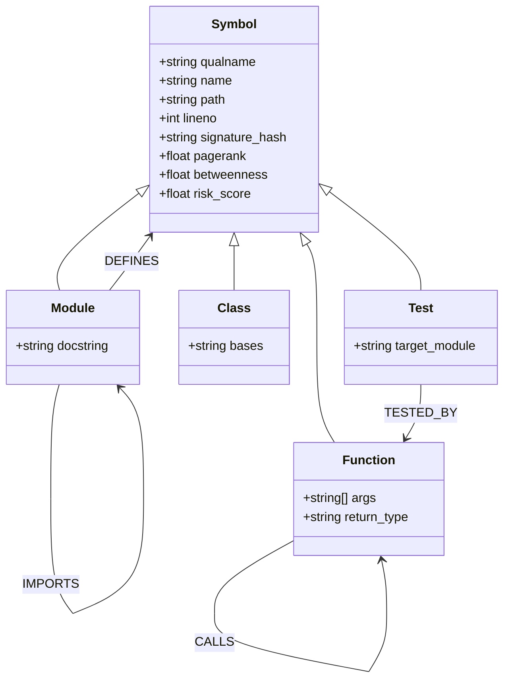

# ChronoFork — Graph-Coordinated Coding Swarm

> **"Git catches line conflicts. ChronoFork catches the ones Git can't see."**

[](https://docs.falkordb.com)
[](https://fastapi.tiangolo.com)
[](https://react.dev)
[](https://www.typescriptlang.org)
[](https://github.com/modelcontextprotocol)
[](https://docker.com)

**ChronoFork** is an autonomous multi-agent coding swarm coordinator where **FalkorDB is the core brain**. When multiple AI agents write code in parallel, standard Git tooling only detects direct line overlaps in the same file. If Agent 1 changes a function's return signature and Agent 2 edits a consumer several call hops away in a different file, Git reports *zero conflicts*, merges cleanly, and causes downstream runtime crashes.

ChronoFork compiles code into a live AST symbol graph in FalkorDB, detects multi-hop transitive collisions in single-digit milliseconds, calculates architectural risk using native PageRank and Betweenness algorithms, runs speculative blast-radius simulations on forked graphs, coordinates handoffs via graph edges, and persists episodic memory with dynamic confidence scores across runs.

---

## 🖥️ What It Looks Like

| **1. Clean Workspace & AST Graph** | **2. Git Blind Spot vs 4-Hop Collision** |
|:---:|:---:|
|  |  |
| *1080p instrument console showing AST symbol graph, telemetry panels, and status chips* | *HeroSplit card showing Git merged cleanly with 0 line conflicts while ChronoFork caught the 4-hop chain* |

| **3. Verdict: Naive Git Failure vs ChronoFork Pass** | **4. Callee-First Serialization & Handoff** |
|:---:|:---:|
|  |  |
| *ResultStrip Verdict displaying 5 FAILED / 7 PASSED under naive Git vs 12 PASSED in ChronoFork* | *GraphCanvas animating sequential hop rings, camera fit, and A1 → A2 dependency handoff* |

| **5. Episodic Memory Recall Contrast** | **6. Zero-Path Parallel Safety Proof** |
|:---:|:---:|
|  |  |
| *Memory tab contrasting Run 1 cold start collision against Run 2 rule-adapted zero collisions* | *ZeroPathProof card proving disjoint parallel execution safety across 4 call hops* |

---

## 🏆 Hackathon Tracks Declared

ChronoFork is submitted to **Graph Hacks (FalkorDB)** under both tracks:

### Track 1: Agents That Act on Connected Data
- **AST Code Graph**: Complete Python repository compiled via import-aware AST parsing into FalkorDB with `:Symbol` nodes (`:Module`, `:Class`, `:Function`, `:Test`) connected by `CALLS`, `DEFINES`, `IMPORTS`, and `TESTED_BY` relationships.
- **Transitive Impact Analysis**: Evaluates multi-hop reverse `CALLS` call-chains (`(caller)-[:CALLS*1..4]->(target)`) combined with `TESTED_BY` relationships to identify every downstream consumer and test suite affected by a proposed change.
- **Graph Centrality Risk Scoring**: Employs FalkorDB's native `algo.pageRank('Symbol', 'CALLS')` and `algo.betweenness({nodeLabels: ['Symbol'], relationshipTypes: ['CALLS']})` to measure architectural scarcity and danger, dynamically dictating swarm serialization policies.
- **Speculative Workspace Forking**: Uses FalkorDB graph cloning (`graph.copy`) to create isolated speculative environments (`fork:<run_id>:<agent_id>`) where AST changes are tested for blast-radius expansion before touching physical code.

### Track 2: Agent Memory and Coordination
- **Unified Coordination Graph**: Clones the repo graph into `coord:<run_id>` and overlays multi-agent coordination entities (`:Run`, `:Agent`) directly onto code `:Symbol` nodes via `[:CLAIMS]` edges.
- **Native Cypher Collision Queries**: Single openCypher traversals detect transitive semantic collisions between agents modifying separate files up to 4 call hops apart.
- **Graph-Driven Handoffs & Merge Order**: Employs `(:Agent)-[:BLOCKED_BY]->(:Agent)` and `(:Agent)-[:HANDED_OFF_TO]->(:Agent)` edges in FalkorDB, with merge sequence dynamically calculated via a callee-first topological graph query.
- **Cross-Run Episodic & Procedural Memory**: Persistent graph `mem:<repo>` stores historical `Episode`s and `ProceduralRule`s linked to code `:Symbol` nodes via `[:INVOLVED]`.
- **Dynamic Heuristic Confidence**: Procedural rules carry confidence scores that rise on verified execution (+0.10) and fall on failure (-0.20), strictly clamped to [0.10, 0.99]. Agents recall these rules upfront, automatically adapting their plans to prevent collisions before claiming nodes.

---

## ⚡ Why FalkorDB is Irreplaceable (No Decorative Graph)

If FalkorDB is removed, **ChronoFork stops working entirely**. ChronoFork cannot be implemented on traditional relational, document, or key-value stores for fundamental architectural reasons:

1. **Arbitrary-Depth Transitive Call Paths**: Detecting whether Agent 2's target calls Agent 1's target requires querying `(s2)-[:CALLS*1..4]->(s1)`. In SQL, this requires recursive Common Table Expressions (CTEs) with multiple self-joins that quickly become unmanageable and unindexable. In FalkorDB, openCypher evaluates this 4-hop path in **4.1 ms**.
2. **Native Graph Centrality**: PageRank and Betweenness Centrality determine whether a symbol is an architectural bottleneck. Running these on relational tables requires exporting the entire graph to an external compute engine. FalkorDB executes `CALL algo.pageRank('Symbol', 'CALLS')` in **19.3 ms** directly inside Redis memory.
3. **Instant Graph Branching (`graph.copy`)**: In ChronoFork, every agent gets an isolated copy of the repository graph to simulate its blast radius. FalkorDB copies a full symbol graph in **36.5 ms**, enabling lightweight speculative execution.
4. **Unified Coordination & Code Model**: Coordination nodes (`Agent`) connect directly to code nodes (`Symbol`) via `[:CLAIMS]` edges. A single Cypher query traverses from Agent across a Claim edge to Symbol across 4 CALL hops to another Claim and another Agent, returning the full node/edge chain for visualization.

---

## 🏗️ System Architecture

```mermaid
flowchart TB
    subgraph UI["Frontend Console (React 19 + Cytoscape.js)"]
        UI_Controls["Control Panel & Scenarios"]
        UI_Graph["Cytoscape Live Graph Canvas (Persistent Halos)"]
        UI_Inspector["Live Cypher Telemetry & AST Inspector"]
        UI_Drawer["Fork Diff, Real Pytest & Memory Drawer"]
    end

    subgraph Backend["FastAPI Backend (Port 8000)"]
        API["FastAPI Endpoints (/runs, /graph, /memory)"]
        SSE["In-Memory SSE Buffer (Zero-Drop Replay)"]
        Runner["Scenario Orchestrator (Scenarios 1-4)"]
        Parser["Import-Aware AST Parser"]
        FastMCP["FastMCP Server (7 Native Tools)"]
    end

    subgraph Agents["Autonomous Swarm & Real Workspaces"]
        Planner["Planner Agent"]
        Coder1["Coder 1 (ConfigCoder)"]
        Coder2["Coder 2 (WorkerCoder)"]
        Verifier["Verifier Agent (Pytest)"]
        Workspaces["Isolated Workspace Copies (/tmp/chronofork_*)"]
        GitExp["Naive Git Merge Experiment Sandbox"]
    end

    subgraph FalkorDB["FalkorDB Multigraph Brain (Ports 6379 & 3000 / Cloud)"]
        RepoGraph[("repo:<name>\nCode Symbol Graph")]
        CoordGraph[("coord:<run_id>\nLive Claims, Handoffs & Collisions")]
        ForkGraph[("fork:<run_id>:<agent_id>\nSpeculative Blast Radius")]
        MemGraph[("mem:<repo>\nEpisodic & Procedural Memory")]
    end

    UI_Controls -->|POST /runs| API
    API --> Runner
    Runner --> FastMCP
    FastMCP --> FalkorDB
    Runner --> Agents
    Agents --> Workspaces
    Agents --> GitExp
    Verifier -->|Run Real Pytest| Workspaces
    Runner -->|Emit Event with Telemetry| SSE
    SSE -->|GET /runs/:id/events (SSE)| UI_Graph
    SSE --> UI_Inspector
    API -->|GET /graph/:name| UI_Graph
    API -->|GET /memory/:repo| UI_Drawer
```

---

## 📊 Graph Data Models

ChronoFork utilizes FalkorDB's multigraph architecture. FalkorDB graph keys are isolated, allowing high-performance branching and multi-tenancy.



### 1. `repo:<name>` (Base Code Graph)
Every code element has the primary label `:Symbol` plus a specific label (`:Module`, `:Class`, `:Function`, `:Test`). This multi-label schema allows algorithms like PageRank to score the entire graph uniformly:
- **Nodes**:
  - `(:Symbol:Module)`: Python modules with filesystem path and import table.
  - `(:Symbol:Class)`: Classes with inheritance hierarchy.
  - `(:Symbol:Function)`: Functions/methods with signature hash, arguments, and line numbers.
  - `(:Symbol:Test)`: Unit tests.
- **Edges**:
  - `[:DEFINES]`: Parent scope to child symbol.
  - `[:IMPORTS]`: Module-to-module dependencies.
  - `[:CALLS]`: Function invocation resolved via import table.
  - `[:TESTED_BY]`: Test function targeting a production function.

### 2. `coord:<run_id>` (Coordination Graph)
Initialized at run start by cloning `repo:<name>` using `GRAPH.COPY`. Coordination entities attach directly to code nodes:
- **Nodes**:
  - `(:Run {run_id, task, status})`
  - `(:Agent {id, name, role, color})`
  - Cloned AST Code `:Symbol` nodes
- **Edges**:
  - `(:Agent)-[:CLAIMS {intent, subtask}]->(:Symbol)` (Intents: `SIGNATURE_CHANGE`, `BODY_EDIT`, `DELETE`, `ADD`)
  - `(:Agent)-[:BLOCKED_BY]->(:Agent)`
  - `(:Agent)-[:HANDED_OFF_TO {reason}]->(:Agent)`

### 3. `fork:<run_id>:<agent_id>` (Speculative Graph)
Cloned from `repo:<name>` per agent. The agent applies proposed edits speculatively (e.g. changing signature, removing callers), re-runs impact and centrality calculations, and computes before/after delta scores.

### 4. `mem:<repo>` (Persistent Memory Graph)
Cross-run memory preserving lessons learned:
- **Nodes**:
  - `(:Symbol {qualname})`
  - `(:Episode {id, run_id, task, outcome, summary, timestamp})`
  - `(:ProceduralRule {id, rule, advice, recommended_intent, confidence, samples})`
- **Edges**:
  - `(:Episode)-[:INVOLVED]->(:Symbol)`
  - `(:Episode)-[:LEARNED_RULE]->(:ProceduralRule)`
  - `(:ProceduralRule)-[:INVOLVED]->(:Symbol)`

---

## 🔍 Core Cypher Queries & Graph Algorithms

### 1. Multi-Hop Transitive Collision Detection
**Why a graph is required**: Detects when Agent A is altering a function signature while Agent B is editing a downstream consumer up to 4 call hops away in a different file.

```cypher
MATCH (a1:Agent)-[c1:CLAIMS]->(s1:Symbol),
      (a2:Agent)-[c2:CLAIMS]->(s2:Symbol)
WHERE a1.id <> a2.id
  AND c1.intent IN ['SIGNATURE_CHANGE', 'DELETE']
MATCH path = (s2)-[:CALLS*1..4]->(s1)
RETURN a1.id AS agent_a,
       a2.id AS agent_b,
       s1.qualname AS target_a,
       s2.qualname AS target_b,
       [n IN nodes(path) | n.qualname] AS path_nodes,
       length(path) AS hops,
       c1.intent AS intent_a,
       c2.intent AS intent_b
```

### 2. Native PageRank Risk Scoring
**Why a graph is required**: Measures global topological importance over all function calls in the repo. High-PageRank symbols receive higher risk scores and trigger `SERIALIZE` policies rather than optimistic merging.

```cypher
CALL algo.pageRank('Symbol', 'CALLS')
YIELD node, score
RETURN node.qualname AS qualname, score AS pagerank
ORDER BY pagerank DESC
```

### 3. Native Betweenness Centrality
**Why a graph is required**: Pinpoints connector functions that sit on the shortest paths between different modules. Modifying high-betweenness nodes threatens multiple subsystems simultaneously.

```cypher
CALL algo.betweenness({
  nodeLabels: ['Symbol'],
  relationshipTypes: ['CALLS']
})
YIELD node, score
RETURN node.qualname AS qualname, score AS betweenness
ORDER BY betweenness DESC
```

### 4. Dynamic Callee-First Merge Order Query
**Why a graph is required**: When multiple agents have conflicting claims, this topological query orders agents so that dependencies (callees) are patched, verified, and merged before callers run.

```cypher
MATCH (a:Agent)-[c:CLAIMS]->(s:Symbol)
OPTIONAL MATCH (s)<-[:CALLS*1..4]-(s_caller:Symbol)<-[:CLAIMS]-(a_caller:Agent)
RETURN a.id AS agent_id,
       a.name AS agent_name,
       s.qualname AS symbol,
       count(s_caller) AS depth
ORDER BY depth DESC
```

### 5. Multi-Hop Reverse Impact Analysis
**Why a graph is required**: When a symbol is touched, traverses callers in reverse direction along with test coverage edges to immediately construct the blast radius and pytest execution plan.

```cypher
MATCH (target:Symbol {qualname: $qualname})
OPTIONAL MATCH path = (caller:Symbol)-[:CALLS*1..4]->(target)
OPTIONAL MATCH (target)<-[:TESTED_BY]-(direct_test:Test)
OPTIONAL MATCH (caller)<-[:TESTED_BY]-(transitive_test:Test)
RETURN collect(DISTINCT caller.qualname) AS dependent_callers,
       collect(DISTINCT direct_test.qualname) + collect(DISTINCT transitive_test.qualname) AS affected_tests
```

### 6. Cross-Run Procedural Rule Recall
**Why a graph is required**: Agents query the memory graph for past procedural rules linked to symbols within a 2-hop radius of their assigned tasks, retrieving lessons learned from previous runs.

```cypher
MATCH (s:Symbol)<-[:INVOLVED]-(rule:ProceduralRule)
WHERE s.qualname IN $qualnames
RETURN rule.id AS id,
       rule.rule AS rule,
       rule.advice AS advice,
       rule.confidence AS confidence,
       collect(DISTINCT s.qualname) AS involved_symbols
ORDER BY rule.confidence DESC
```

---

## 📈 Measured FalkorDB Benchmarks

All metrics measured live on a real FalkorDB v4.22.1 instance running inside Docker using `scripts/verify_phase0.py` and `scripts/verify_item1.py` (see [`docs/falkordb-verified.md`](docs/falkordb-verified.md)):

| Operation | FalkorDB Command / Method | Measured Latency |
| :--- | :--- | :--- |
| **Graph Clone** | `graph.copy(dest)` | **36.50 ms – 84.81 ms** |
| **PageRank Centrality** | `CALL algo.pageRank('Symbol', 'CALLS')` | **19.30 ms – 21.73 ms** |
| **Betweenness Centrality** | `CALL algo.betweenness({nodeLabels: [...], ...})` | **7.67 ms – 13.62 ms** |
| **Variable-Length Path Traversal** | `(s2)-[:CALLS*1..4]->(s1)` | **4.12 ms – 4.31 ms** |
| **Shortest Path Calculation** | `CALL algo.SPpaths(...)` | **2.02 ms – 4.30 ms** |
| **Real Pytest Verification** | Subprocess pytest on merged workspace | **0.45s (12 passed)** |

---

## 🛠️ FastMCP Tool Reference

ChronoFork exposes 7 standardized tools via the official Python `mcp` SDK (`FastMCP` / `MCPServer`). These tools can be connected to external MCP clients (Cursor, Claude Desktop, Antigravity) or called directly in-process by ChronoFork's internal orchestrator:

1. `get_impact(repo_name, qualname, max_hops=4)`: Returns all dependent callers and affected unit tests.
2. `rank_risk(repo_name)`: Computes PageRank and Betweenness centrality, returning normalized risk scores (0.0 to 1.0).
3. `claim_symbols(run_id, agent_id, qualnames, intent, reason)`: Registers claims in `coord:<run_id>` with intent type.
4. `detect_collisions(run_id)`: Traverses claims and returns collision paths, hop counts, and resolution policies.
5. `fork_graph(run_id, agent_id, repo_name)`: Creates a speculative fork using `graph.copy`.
6. `recall_memory(repo_name, symbol_qualnames)`: Retrieves relevant `ProceduralRule`s and past `Episode`s.
7. `record_episode(repo_name, run_id, task, outcome, summary, involved_symbols, rule_learned)`: Persists run results and adjusts rule confidence.

---

## 🎭 The 4 Live Execution Scenarios

ChronoFork includes 4 comprehensive demo scenarios that run real workspace code with zero external LLM API dependency:

```
┌─────────────────────────────────────────────────────────────────────────────┐
│ 1. HIDDEN 4-HOP COLLISION & NAIVE GIT MERGE FAILURE                         │
│    Agent 1 changes load_config signature; Agent 2 edits worker.execute_job. │
│    Call chain: worker -> queue -> auth -> database -> config (4 hops).     │
│    Naive Git Experiment: Git merges cleanly (0 conflicts), then pytest      │
│    crashes with 5 FAILED tests!                                             │
│    ChronoFork: Detects 4-hop chain -> SERIALIZE -> Real Pytest: 12 PASSED!  │
├─────────────────────────────────────────────────────────────────────────────┤
│ 2. MEMORY-DRIVEN COLLISION AVOIDANCE (With Memory ON/OFF Toggle)            │
│    Reruns task; ConfigCoder recalls ProceduralRule (90% confidence) upfront.│
│    Agent proactively adapts intent from SIGNATURE_CHANGE to BODY_EDIT.      │
│    Collision check: 0 collisions -> Swarm executes concurrently!            │
│    Toggle Memory OFF: Swarm forgets lesson and collision returns!           │
├─────────────────────────────────────────────────────────────────────────────┤
│ 3. SAFE PARALLEL EXECUTION                                                  │
│    Agent 1 claims worker.execute_job; Agent 3 claims reports.generate.      │
│    FalkorDB verifies disjoint subgraphs -> PARALLEL_OK -> Concurrent merge! │
├─────────────────────────────────────────────────────────────────────────────┤
│ 4. MULTI-TENANT REPOSITORY ISOLATION                                        │
│    Switches active graph to repo:analytics; Memory in mem:analytics clean. │
│    Proves absolute multi-tenant namespace isolation across repositories.    │
└─────────────────────────────────────────────────────────────────────────────┘
```

---

## 🚀 Quickstart & Setup

### Option A: One-Command Docker Compose (Recommended)

Start the entire stack (FalkorDB + FastAPI backend + React Vite frontend) in a single command:

```bash
docker compose up --build
```

- **ChronoFork Ops-Console**: [http://localhost:5173](http://localhost:5173)
- **FastAPI Documentation**: [http://localhost:8000/docs](http://localhost:8000/docs)
- **FalkorDB Browser GUI**: [http://localhost:3000](http://localhost:3000)

Both demo repositories (`repo:taskflow` and `repo:analytics`) are auto-seeded into FalkorDB on startup.

---

### Option B: Local Development Setup

#### 1. Prerequisites
- Docker (for FalkorDB)
- Python 3.11+
- Node.js 18+ and npm

#### 2. Start FalkorDB
```bash
docker run -d -p 6379:6379 -p 3000:3000 --name falkordb falkordb/falkordb:latest
```

#### 3. Setup and Run Backend
```bash
# In project root
python -m venv venv
# On Linux/macOS:
source venv/bin/activate
# On Windows:
.\venv\Scripts\activate

pip install -r backend/requirements.txt
uvicorn backend.app.main:app --host 0.0.0.0 --port 8000 --reload
```

#### 4. Setup and Run Frontend
```bash
cd frontend
npm install
npm run dev
```
Open [http://localhost:5173](http://localhost:5173).

---

### Option C: Connecting to FalkorDB Cloud

ChronoFork supports secure TLS connections to FalkorDB Cloud. Set the following environment variables (or place them in a `.env` file):

```bash
FALKORDB_HOST="your-falkordb-cloud-host.cloud.falkordb.com"
FALKORDB_PORT=6379
FALKORDB_USERNAME="default"
FALKORDB_PASSWORD="your-secure-password"
FALKORDB_SSL="true"
```

---

## 🧪 Verification & Acceptance Test Suite

Run the full verification test suite locally:

```bash
# 1. FalkorDB Syntax & Performance Benchmark Verification
python scripts/verify_phase0.py

# 2. Ingestion & Reverse CALLS Impact Analysis (4-Hop Chain)
python scripts/test_p1.py

# 3. Claims, Fork Simulation & Transitive Collision Detection
python scripts/test_p2.py

# 4. Memory Graph & Procedural Rule Confidence Rise/Fall
python scripts/test_p3.py

# 5. FastMCP Tools, In-Memory SSE Buffering & Replay Backend
python scripts/test_p4.py

# 6. Real Workspace Patches & Pytest Verification
python scripts/test_p6.py

# 7. Comprehensive 4-Scenario End-to-End Suite
python scripts/test_all_scenarios.py
```

---

## 🤖 AI Assistant Disclosure

ChronoFork was created for the FalkorDB Graph Hacks Hackathon. An AI coding assistant (Google DeepMind Antigravity) was used during development for scaffolding boilerplate, syntax cross-checking, and interactive pair-programming. Every Cypher query, AST algorithm, and coordination policy was verified on live FalkorDB instances and designed to be human-readable, maintainable, and explained in detail.

---

## 📚 Documentation & Hackathon Deliverables

- 📝 **[Technical Submission Blog Post](docs/blog-post.md)**: Deep dive into the architecture, Git blind spot proof, FalkorDB benchmarks, and coordination algorithms.
- 🎬 **[Demo Video Script & Storyboard](docs/demo-script.md)**: Timed 3-minute video presentation script.
- 🔬 **[FalkorDB Live Verification Report](docs/falkordb-verified.md)**: Empirical benchmarks and syntax verification on live FalkorDB v4.22.1.
- 📖 **[Master Codebase & Architecture File](CHRONOFORK_ALL_CODE_AND_EXPLANATION.md)**: Single comprehensive document containing every line of code with implementation explanations.

---

## 📄 License

MIT License. Designed and engineered for FalkorDB Graph Hacks.
