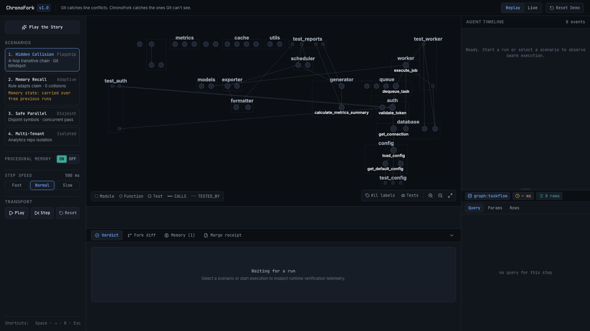
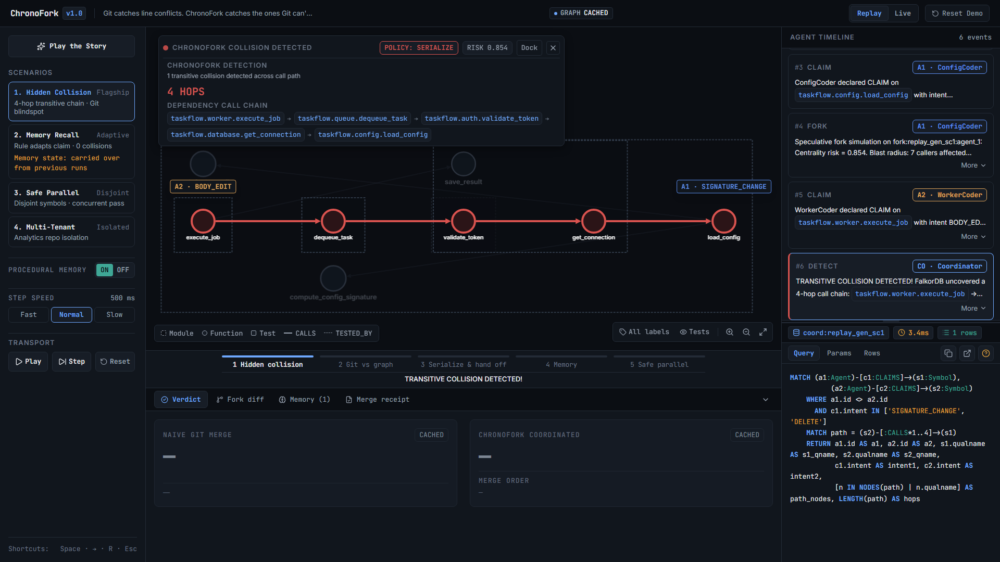
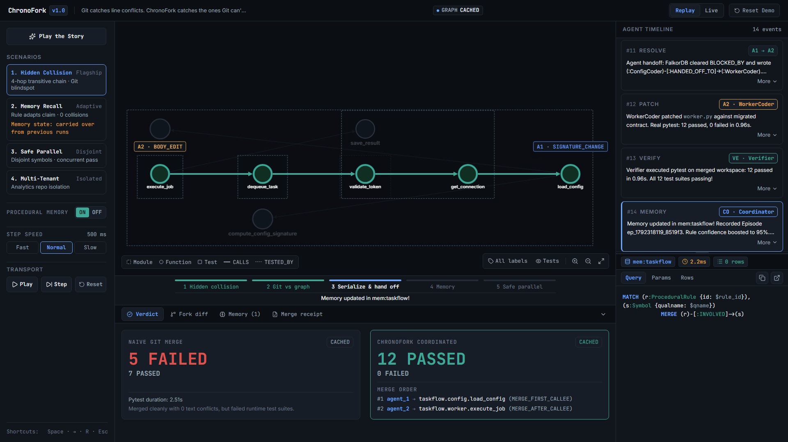
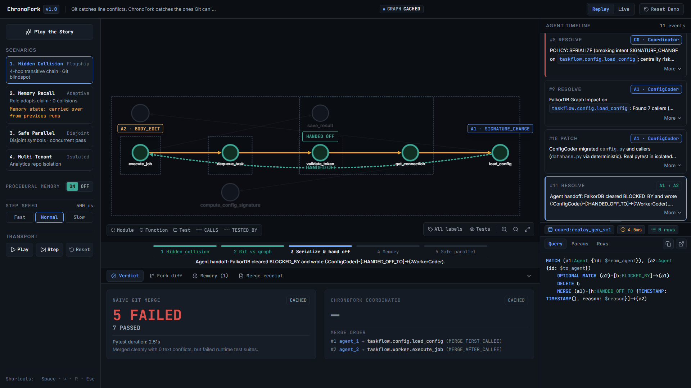
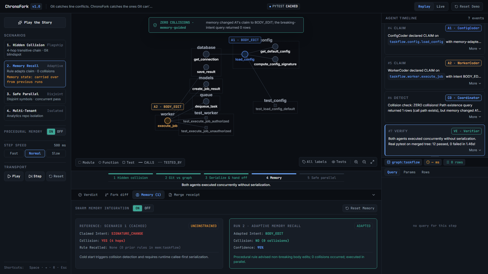
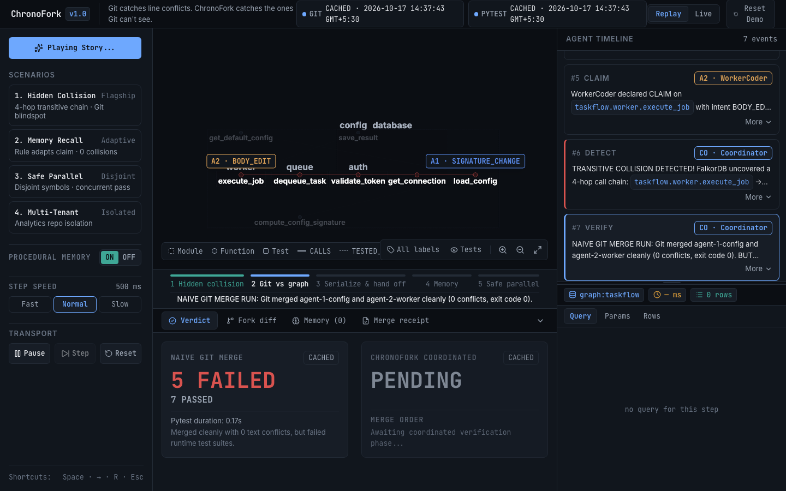
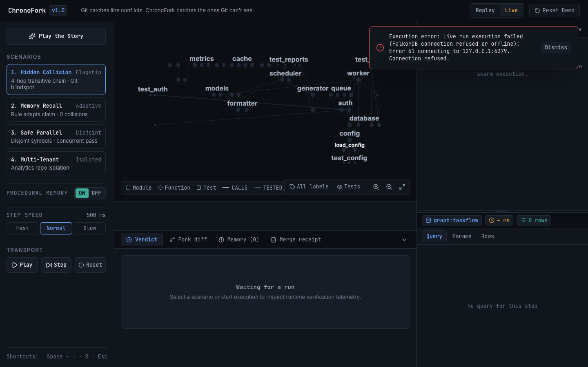
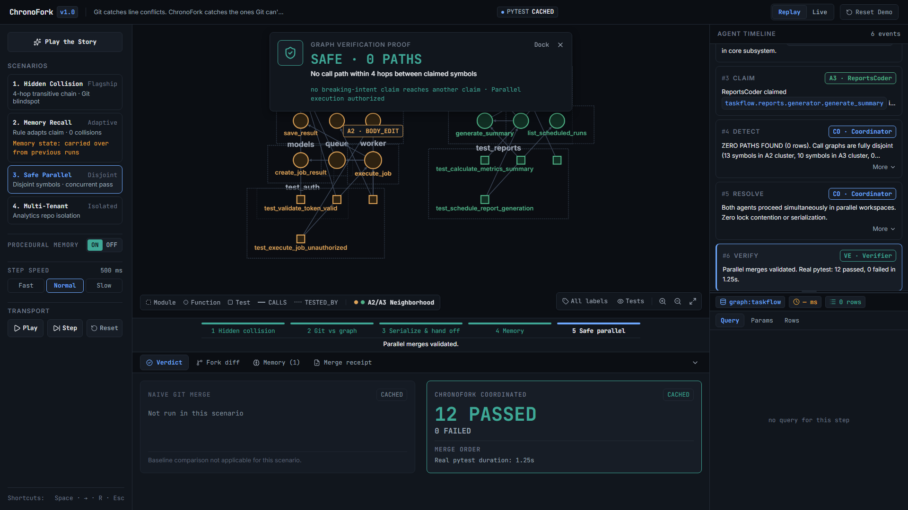
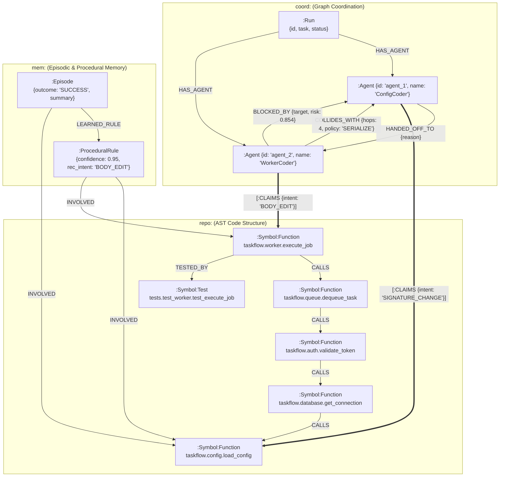

# ChronoFork — Graph-Coordinated Coding Swarm

> **"Git catches line conflicts. ChronoFork catches the ones Git can't see."**

[](https://docs.falkordb.com)
[](https://fastapi.tiangolo.com)
[](https://react.dev)
[](https://www.typescriptlang.org)
[](https://docker.com)

---

## ⚡ 20-Second Explanation

When multiple AI agents write code in parallel, Git only detects direct line overlaps in the same file. If Agent 1 changes a function's signature (`load_config`) and Agent 2 edits a consumer 4 call hops away (`execute_job`), Git merges cleanly with **0 text conflicts** — but CI immediately crashes at runtime with `TypeError`.

**ChronoFork** compiles repositories into an openCypher code graph in **FalkorDB**. Agents claim symbols on the graph before writing code. A single multi-hop Cypher traversal detects transitive collisions in **~1-2 ms (median 1.97 ms)**, calculates architectural risk via native PageRank and Betweenness, enforces topological callee-first serialization, and records procedural memory so agents learn from collisions and never repeat them.

---

## 🖥️ Screenshot Gallery

| **1. Clean Workspace & AST Graph** | **2. Git Blind Spot vs 4-Hop Collision** |
|:---:|:---:|
|  |  |
| *1080p instrument console displaying AST symbol graph, telemetry panels, and status chips* | *HeroSplit card contrasting Git's 0-conflict clean merge against ChronoFork's 4-hop chain detection* |

| **3. Verdict: Naive Git Failure vs ChronoFork Pass** | **4. Callee-First Serialization & Handoff** |
|:---:|:---:|
|  |  |
| *Telemetry drawer displaying real pytest verification: 5 failed / 7 passed under Git vs 12 passed in ChronoFork* | *Cytoscape canvas rendering sequential hop rings, camera fit, and A1 → A2 dependency handoff* |

| **5. Episodic Memory Recall Contrast** | **6. Clean Clone Live Execution (Docker)** |
|:---:|:---:|
|  |  |
| *Memory tab contrasting Run 1 cold start collision against Run 2 rule-adapted zero collisions* | *Production Nginx static container running live Story mode inside Docker Compose* |

| **7. Fail-Loudly Zero-Fallback Proof** | **8. Zero-Path Parallel Safety Proof** |
|:---:|:---:|
|  |  |
| *Live execution with FalkorDB container stopped: displays explicit red HTTP 503 error toast without fallback* | *ZeroPathProof card proving disjoint parallel execution safety across 4 call hops* |

---

## 🔍 Data Provenance: REAL vs CACHED

ChronoFork treats data integrity with complete transparency:
1. **Replay Mode**: Serves cached event streams (`replays/scenario_N.json`) generated earlier by real live executions. Every event header clearly displays a `CACHED` badge alongside its original capture date.
2. **Live Execution Mode**: Interacts live with FalkorDB, writes real Git branches, and executes real `pytest` in isolated workspaces. Every event displays a `REAL` badge.
3. **Deterministic Scripted Agents**: Agent code modifications in this submission are executed via **deterministic scripted patches** to reliably demonstrate specific multi-hop collision chains. Live LLM execution via Gemini API is scaffolded in `backend/app/agents/llm.py`, but LLM mode is **NOT validated** against production API keys.
4. **Captured Timestamps**: `captured_at` represents the exact timestamp of event emission.
5. **Procedural Memory Confidence**: Initial rule confidence of `0.85` is a chosen prior. On verified successful runs, confidence rises by `+0.10`; on failure, it decreases by `-0.20`, clamped strictly between `[0.10, 0.99]`.

---

## 🚀 Quickstart

> [!WARNING]
> **Deployment Security (`DEMO_MODE`)**:
> `docker-compose.yml` defaults to **`DEMO_MODE=true`** (`DEMO_MODE=${DEMO_MODE:-true}`) for safe public and shared hosting.
> In live mode (`DEMO_MODE=false`), the backend executes real subprocess Git commands and real `pytest` in temporary workspaces. For any public deployment, `DEMO_MODE` **MUST remain `true`** to restrict execution to verified cached replays and prevent untrusted subprocess execution.
> To enable live Git/pytest execution locally:
> ```bash
> DEMO_MODE=false docker compose up --build -d
> ```

### Option A: Complete Docker Compose Deployment (Recommended)
Runs containerized FalkorDB, FastAPI backend with auto-seed, and production Nginx frontend:
```bash
docker compose up --build -d
```
- **Frontend**: [http://localhost:5173](http://localhost:5173) (Static build served by Nginx, reverse-proxying API calls)
- **Backend API**: [http://localhost:8000](http://localhost:8000) (FastAPI REST & SSE streaming)
- **Health Check**: [http://localhost:8000/health](http://localhost:8000/health)

### Option B: Local Development
Prerequisites: Docker, Python 3.11, Node.js 18+.

1. **Start FalkorDB**:
   ```bash
   docker compose up -d falkordb
   ```
2. **Start Backend**:
   ```bash
   python3 -m venv .venv
   source .venv/bin/activate
   pip install -r backend/requirements.txt
   export PYTHONPATH=.
   uvicorn backend.app.main:app --host 127.0.0.1 --port 8000
   ```
3. **Start Frontend**:
   ```bash
   cd frontend
   npm install
   npm run dev
   ```

---

## 🏆 Hackathon Tracks Declared

ChronoFork is submitted to **Graph Hacks (FalkorDB)** under both tracks:

### Track 1: Agents That Act on Connected Data
- **AST Code Graph**: Python repositories compiled into FalkorDB with `:Symbol` nodes (`:Module`, `:Class`, `:Function`, `:Test`) connected by `CALLS`, `DEFINES`, `IMPORTS`, and `TESTED_BY` relationships.
- **Transitive Impact Analysis**: Evaluates multi-hop reverse `CALLS` call-chains (`(caller)-[:CALLS*1..4]->(target)`) to determine downstream blast radius.
- **Graph Centrality Risk Scoring**: Employs native FalkorDB algorithms `CALL algo.pageRank('Symbol', 'CALLS')` and `CALL algo.betweenness({nodeLabels: ['Symbol'], relationshipTypes: ['CALLS']})` to measure architectural bottleneck risk.
- **Speculative Workspace Forking**: Uses FalkorDB graph cloning (`graph.copy`) to create isolated speculative environments (`fork:<run_id>:<agent_id>`).

### Track 2: Agent Memory and Coordination
- **Unified Coordination Graph**: Clones repo graph into `coord:<run_id>` and overlays multi-agent coordination entities (`:Run`, `:Agent`) directly onto code `:Symbol` nodes via `[:CLAIMS]` edges.
- **Native Cypher Collision Queries**: Single openCypher traversals detect transitive semantic collisions between agents modifying separate files up to 4 call hops apart.
- **Graph-Driven Handoffs & Merge Order**: Employs `(:Agent)-[:BLOCKED_BY]->(:Agent)` and `(:Agent)-[:HANDED_OFF_TO]->(:Agent)` edges in FalkorDB, with merge sequence calculated via callee-first topological traversal.
- **Cross-Run Procedural Memory**: Persistent graph `mem:<repo>` stores historical `Episode` and `ProceduralRule` nodes linked to code `:Symbol` nodes via `[:INVOLVED]`.

---

## 📊 Graph Data Model (AS IMPLEMENTED)



---

## ⚡ Core Cypher Queries (Verbatim from Code)

### 1. Transitive Multi-Hop Collision Detection
From [`backend/app/coordinator.py:160-170`](backend/app/coordinator.py#L160-L170):
```cypher
MATCH (a1:Agent)-[c1:CLAIMS]->(s1:Symbol),
      (a2:Agent)-[c2:CLAIMS]->(s2:Symbol)
WHERE a1.id <> a2.id
  AND c1.intent IN ['SIGNATURE_CHANGE', 'DELETE']
MATCH path = (s2)-[:CALLS*1..4]->(s1)
RETURN a1.id AS a1, a2.id AS a2, s1.qualname AS s1_qname, s2.qualname AS s2_qname,
       c1.intent AS intent1, c2.intent AS intent2,
       [n in nodes(path) | n.qualname] AS path_nodes, length(path) AS hops
```
*Why a graph is required*: Detecting arbitrary-depth caller chains across separate files in SQL requires recursive CTEs with expensive self-joins. In FalkorDB, openCypher evaluates this 4-hop chain in **~1-2 ms**.

### 2. Native Graph Centrality Risk Scoring
From [`backend/app/algorithms.py:30-45`](backend/app/algorithms.py#L30-L45):
```cypher
-- PageRank (Structural Dependency Scarcity)
CALL algo.pageRank('Symbol', 'CALLS') YIELD node, score
RETURN node.qualname AS qualname, score ORDER BY score DESC

-- Betweenness Centrality (Call Bridge Bottleneck)
CALL algo.betweenness({nodeLabels: ['Symbol'], relationshipTypes: ['CALLS']}) YIELD node, score
RETURN node.qualname AS qualname, score ORDER BY score DESC
```
*Unified Risk Formula* ([`algorithms.py:53-56`](backend/app/algorithms.py#L53-L56)):
$$\text{Risk}(S) = 0.5 \times \frac{\text{PageRank}(S)}{\max(\text{PageRank})} + 0.5 \times \frac{\text{Betweenness}(S)}{\max(\text{Betweenness})}$$
For `taskflow.config.load_config`: PageRank = 0.0561 (norm 1.0000), Betweenness = 34.0 (max 48.0, norm 0.7083) $\to \mathbf{0.854}$.
*Policy Rule*: Any collision where Agent 1 claims `SIGNATURE_CHANGE` or `DELETE` **forces policy `SERIALIZE_CALLEE_FIRST`** regardless of risk threshold, ensuring the callee change lands before callers adapt.

### 3. Procedural Memory Recall
From [`backend/app/memory.py:175-185`](backend/app/memory.py#L175-L185):
```cypher
MATCH (s:Symbol)<-[:INVOLVED]-(r:ProceduralRule)
WHERE s.qualname IN $qnames
RETURN DISTINCT r.id AS id, r.rule AS rule, r.advice AS advice,
       r.confidence AS confidence, r.samples AS samples,
       s.qualname AS trigger_symbol, r.recommended_intent AS recommended_intent
ORDER BY r.confidence DESC
```

---

## 📈 Measured Performance & Benchmarks

All metrics documented here derive strictly from `docs/NUMBERS.md` and underlying raw logs.

### 1. FalkorDB Query Latency on `repo:taskflow` (69 Symbols, 29 Calls, 16 Tests)
*Measured over real execution runs (`docs/evidence/phase2/falkordb_bench_stdout.txt`, `docs/evidence/phase8/benchmark_detection_stdout.txt`):*
- **`graph.copy`**: Range = **~55-112 ms** (Min = 55.41 ms, **Median = 108.32 ms**, Max = 112.08 ms)
- **`algo.pageRank`**: Range = **~1-2 ms** (Min = 1.20 ms, **Median = 1.36 ms**, Max = 1.99 ms)
- **`algo.betweenness`**: Range = **~1-3 ms** (Min = 1.39 ms, **Median = 1.80 ms**, Max = 2.60 ms)
- **Collision Detection Query**: Range = **~1-2 ms** (Min = 1.13 ms, **Median = 1.97 ms**, Max = 6.06 ms)

### 2. Collision Detection Benchmark ($N = 58$ Seeded Cases)
*Ground truth established strictly by merged-tree `pytest` execution (`docs/evidence/phase8/benchmark_detection_stdout.txt`):*

| Detector | When Collision is Known | Precision | Recall | Median Latency |
|---|---|:---:|:---:|:---:|
| **(a1) Git text conflict only** | Merge time (text only) | 0.0% | 0.0% | N/A |
| **(a2) Per-branch repo tests** | Pre-merge (isolated branch) | 0.0% | 0.0%* | N/A |
| **(a3) Merged-tree repo tests** | Post-merge (runtime CI) | 100.0% | 100.0% | ~0.44-1.1s pytest-internal (~1.5-2.0s wall time) |
| **(b) ChronoFork (FalkorDB)** | **Claim time (pre-code)** | **100.0%** | **57.9%** | **~1-2 ms (1.97 ms)** |

*\*Note: (a2) is 0% recall by construction because tests on an isolated branch never execute cross-branch unmerged changes.*

**Headline Per-Pattern Recall**:
- Standard static call chains (`direct_call`, `two_hops`, `three_hops`, `four_hops`, `import_inside_function`): **100% Recall** (22/22 detected).
- Safe concurrent changes (`unrelated_pairs`, `same_module_disjoint`, `nearby_no_call`, `body_edit_only`, `unused_function_rename`): **100% Specificity** (20/20 safe, **Zero False Positives**).
- Dynamic metaprogramming (`self_method`, `getattr_call`, `alias_call`, `dict_dispatch`): **0% Recall** (Documented static AST blind spots).

### 3. Real Verification Pytest Timings
- **Naive Git Merge**: **5 FAILED**, 7 PASSED in **0.44s** (pytest-internal duration; **~1.48s** wall clock duration).
- **ChronoFork Serialized**: **12 PASSED**, 0 FAILED in **0.15s** (pytest-internal duration; **~0.96s** wall clock duration).

---

## ⚠️ System Limitations & Honest Scope

1. **Max Traversal Bound ($k \le 4$)**: The coordinator query uses `[:CALLS*1..4]`. Any dependency chain of length $k \ge 5$ is silent unless the bound is expanded.
2. **Dynamic Metaprogramming**: Dynamic Python patterns (`getattr`, dictionary dispatch tables, variable aliasing) cannot be resolved by static AST visitors without runtime dataflow.
3. **Instance Method Linking**: In `worker = ServiceWorker(); worker.f()`, the static visitor links the call to the class `ServiceWorker` rather than the method symbol `ServiceWorker.f` without receiver type inference.
4. **Signature Breaks Only**: Benchmark ground truth evaluates signature incompatibilities (`TypeError`). Semantic state invariants without signature changes are not detected.
5. **Fork Simulation Scope**: Speculative fork simulation (`fork:<run_id>:<agent_id>`) creates an isolated graph copy (`graph.copy`) used strictly to evaluate blast radius and identify affected upstream dependents in isolation before filesystem edits occur. Because it is an isolated structural copy used for blast radius calculation, it does not apply the patch to the graph schema, so the measured architectural risk score remains identical before and after simulation (`risk before == after`, 0.854).

---

## 🤖 AI Disclosure

- **Google Antigravity**: Used for autonomous codebase implementation, Playwright end-to-end verification, test authoring, and Docker containerization.
- **Anthropic Claude**: Used for initial design review, architectural planning, and benchmark methodology analysis.
- **Personal Verification**: Verified by Vivek C K and Souhardya Saha: we ran the clean-clone docker compose up, the benchmark and the 5-failed/12-passed experiment ourselves, checked the docs against docs/NUMBERS.md and the evidence logs, and can explain the schema, the collision query, the risk formula and the memory update.
